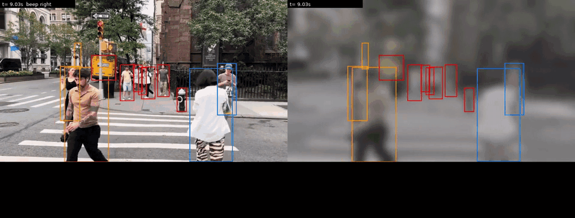
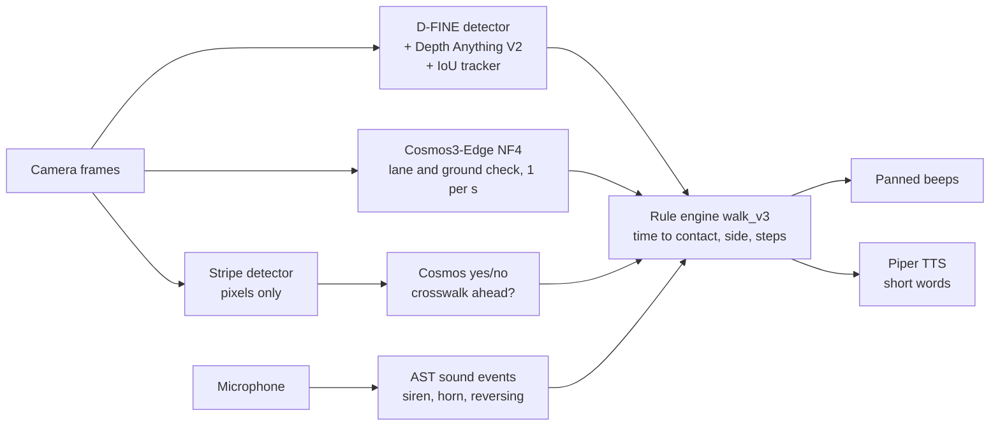

# Maya

**Maya: an offline AI travel aid for blind and low-vision people.**

Private, on-device scene and hazard cues for people with vision loss. No cloud, no
signal needed.

Project web page: https://maya-travel-aid.vercel.app

Built for the IEEE AI Hackathon (Multimodal LLM Challenge). Every model is open and
runs on one laptop GPU. Nothing is sent to a cloud service.



_Left: what Maya sees and says (boxes, and the words it speaks as captions). Right: the
same cues over a blurred, dimmed copy, roughly what a low-vision walker sees. The full
video has sound: panned beeps and Maya's voice over the street. Clip cut from a public
[YouTube walk along Park Avenue](https://www.youtube.com/watch?v=VAjHWBkz_z8), used with
credit for this non-commercial project._

## Who it is for

About 43 million people are blind and 295 million have moderate or severe vision
impairment (IAPB Vision Atlas, 2020 estimates). Most of them still have some sight.
Maya is meant to help:

- people with peripheral field loss (glaucoma, retinitis pigmentosa), who miss things
  to the side. Panned left and right beeps target that.
- people with central vision loss (age-related macular degeneration), who struggle to
  read signs and faces. Sign reading and photo questions help most here.
- long cane users. A cane finds things on the ground but misses obstacles at chest and
  head height, which a chest camera sees.
- older adults who are new to vision loss and may not have had orientation and
  mobility (O&M) training.

Maya is an aid next to the cane or guide dog, not a replacement. Sources and the full user research: [docs/research/users_and_framing.md](docs/research/users_and_framing.md).

## What Maya does

- **Photo questions.** "What does this sign say?", "How many people are in line?",
  "What is on this label?"
- **Video, audio, documents and code.** Ask about a clip, a recording (speech or
  sounds), a PDF, or a coding task. Maya runs generated code in a sandbox and reports
  the result. These are the five item kinds the hackathon judges ask live with Wi-Fi off.
- **Walk mode** (simulated on recorded video). While you walk, Maya plays a short beep
  panned to the side of anything coming at you, and says short words with a step count:
  "Person left, 4.", "Car ahead, close.", "Sign board ahead.", "Curb and crosswalk
  ahead, 4.", "Siren.", "Car horn.", "Truck backing up."

Maya describes; it never decides. It says "Person ahead", never "move left" or "safe to
cross". We tested steering several times and it was wrong or late too often
([docs/EXPERIMENTS.md](docs/EXPERIMENTS.md#cosmos-steering-describe-and-stairs)). The
rule is enforced in the prompts, by a filter on every answer (`app/safety.py`), and by
`tests/test_safety.py`.

## Why fully local, with open models

- Privacy for the user. Blind users of camera apps have said they worry about
  sharing images they cannot check themselves (Akter et al., USENIX Security 2020).
  Maya's frames never leave the laptop and are not stored.
- Privacy for bystanders. A walking camera sees strangers' faces. Keeping every
  frame on the device is the plainest answer to that.
- No signal needed. A cloud model goes silent in stations, underground and in areas
  with poor coverage, often where a traveller needs help.
- Latency. At a walking speed of about 1.07 m/s, every second of network delay is
  about one metre walked before the warning arrives. Maya runs its detector at about 50 ms a frame, with no network round trip.
- No subscription. Once installed there is no per-use cost. It does need a laptop
  with a capable GPU.
- Open models. Every model is open-weight with a published license, so the system
  can be inspected, reproduced and run offline.

## How it works

Walk mode is a pipeline of small models and rules, not one model. A fast layer decides
when to warn; the vision-language model only adds what the fast layer cannot see.



The same in text: camera frames go to the detector, depth and tracker (about 50 ms a
frame) and to a once-a-second Cosmos3-Edge check of the walking lane. A pixel stripe
detector looks for crosswalks, and Cosmos confirms each hit with a yes/no question.
Audio goes to AST for sirens and horns. The rule engine (`scripts/walk_v3.py`) merges
all of it, picks the most urgent thing, and plays a panned beep or speaks a short line
through Piper. One voice, with alerts first.

The photo and Q&A modes run through one engine (`maya/engine.py`) that keeps
Qwen3-VL-4B on the GPU and routes each request by kind.

| Model | Job | License | Runs on |
|---|---|---|---|
| `Qwen/Qwen3-VL-4B-Instruct`, NF4 (about 3.6 GiB) | Photos, video, documents, code, questions about speech | Apache-2.0 | GPU |
| `Qwen/Qwen2.5-Coder-7B-Instruct`, NF4 | Code fallback, only after failed self-checks (the VLM is unloaded first) | Apache-2.0 | GPU |
| `ubr-physical-ai/Cosmos3-Edge-NF4-bnb` (about 2.4 GiB) | Walk mode: lane obstacles, ground, crosswalk confirm | OpenMDW-1.1 | GPU |
| `ustc-community/dfine-small-obj365` | Walk mode: object detection | Apache-2.0 code. The Objects365 weights are not cleared for commercial use | GPU |
| `depth-anything/Depth-Anything-V2-Metric-Outdoor-Small-hf` | Walk mode: distance | Apache-2.0 | GPU |
| `MIT/ast-finetuned-audioset-10-10-0.4593` (AST) | Walk alerts (siren, horn, reversing), speech or sound routing | BSD-3-Clause | GPU in walk mode, CPU otherwise |
| `laion/clap-htsat-unfused` (CLAP) | Naming sounds in audio items, zero-shot over 122 labels | Apache-2.0 | CPU |
| faster-whisper `small.en` | Speech to text | MIT | CPU |
| Piper (`piper-tts` 1.8) with `en_US-lessac-medium` | Text to speech | GPL-3.0-or-later (engine). The voice has its own model card | CPU |

The dev GPU is an RTX 5060 Laptop with 8 GB, about 2 GB of it held by the display, so
one large model stays on the GPU at a time. Details: [docs/hardware.md](docs/hardware.md).

## Quick start (Docker)

You need Windows 11 with WSL2 and Docker Desktop (or Linux with Docker), an NVIDIA GPU
with 8 GB or more, and Git Bash on Windows. The host needs no Python.

```bash
docker volume create hf-cache
docker build -t maya-cosmos-tf docker/cosmos-tf
docker build -t maya-app docker/app
docker build -t maya-engine docker/engine
```

The first run downloads the models into the `hf-cache` volume. After that everything
works offline (`HF_HUB_OFFLINE=1`).

Run the app and open it on a phone on the same Wi-Fi:

```bash
bash scripts/run_app.sh                  # prints https://<laptop-ip>:8443
MAYA_OFFLINE=1 bash scripts/run_app.sh   # demo mode: no network for model loads
```

The phone has to trust the local certificate once: [docs/phone_setup.md](docs/phone_setup.md).
API details: [docs/app.md](docs/app.md).

Run the tests (CPU only, no models):

```bash
MSYS_NO_PATHCONV=1 docker run --rm --network none -v "$(pwd -W):/app" -w /app \
  -e PYTHONPATH=/app:/app/scripts maya-engine python -m pytest -q tests
```

Score the item kinds: `bash scripts/gpu_job.sh pack python scripts/eval_pack.py --run <name> [--pack <folder>]`
(the practice pack itself is not in the repo).

## Run walk mode on a video

Walk mode runs as a simulation on a recorded clip: it reads the video at its real
speed, times each model call, and writes a log and a rendered video with the beeps
and voice mixed in. The scripts expect the code at `/app` and the clips and outputs at
`/main`, so mount the repo at both.

Put your clip at `test_videos/<name>.mp4`, then:

```bash
MSYS_NO_PATHCONV=1 docker run --rm --gpus all --network none -e HF_HUB_OFFLINE=1 \
  -v hf-cache:/root/.cache/huggingface -v "$(pwd -W):/app" -v "$(pwd -W):/main" \
  -w /app -e PYTHONPATH=/app maya-engine bash -c '
  s=my_walk; v=/main/test_videos/$s.mp4
  python scripts/perception.py --video $v --out /main/results/perception/$s.jsonl --no-video
  python experiments/cosmos_combined/lane_ground_probe.py $v
  python experiments/cosmos_combined/stripes.py $v
  python experiments/cosmos_combined/curb_confirm_probe.py $v
  bash experiments/cosmos_combined/run_recommended.sh $s --tag mine --render-dir /main/results/render \
    --path-steps 1 --corner-steps 1 --curb-confirm 1 --wset far_words=0 --wset steps_depth=1'
```

The steps: tracks from the detector, the once-a-second Cosmos lane check, crosswalk
stripes, the Cosmos crosswalk confirm, then the simulation.
`run_recommended.sh` holds the v11 settings from the frame reviews. The last line adds
v12 (a step count on every word, the crosswalk confirm). Drop those flags for plain v11.
Output: `results/live/<name>_cc_mine/log.csv` and `results/render/<name>.mp4`.

Steering is off. It exists only behind flags for comparison (see the comment in
`run_recommended.sh`).

## Results in short

Walk mode, agent frame reviews of every spoken line on 22 real clips (details and
caveats in [docs/EXPERIMENTS.md](docs/EXPERIMENTS.md#review-table-across-walk-versions)):

| | v1 (first build) | v4 | v10 |
|---|---|---|---|
| Lines | 164 | 107 | 114 |
| Correct and useful | 56 (34%) | 63 (59%) | 58 (51%) |
| Wrong | 38 | 10 | 8 |
| Late | 11 | 5 | 4 |
| Missed events | 47 | 47 | 42 |

- Panned beeps with one word per person warned on time for 24 of 33 people on the SANPO
  chest-camera set, scored by tracked identity, against 15 of 33 for words alone.
- 38 of 45 people walking toward the camera in the held-out clips got a beep or a word
  within 2 s before to 1 s after the moment they mattered.
- The crosswalk stripe detector fires within about 2 s of the curb at 9 of 11 held-out
  corners and stays quiet on 6 sidewalk-only clips.
- Cosmos steering: 1 of 15 lines useful, 6 wrong, 8 late. It stays off.

The judged item kinds (all local, Qwen3-VL-4B as the main model):

| Set | Score |
|---|---|
| Practice pack (our tuning set) | 97/100 |
| Held-out set we generated | 64/68 |
| VizWiz extra (real photos from blind users) | 72/80 |
| SQuAD 2.0 extra (documents, some unanswerable) | 46/60 |
| LibriSpeech extra | 34/40 |
| ESC-50 extra (sounds) | 84/100 |
| HumanEval, all 144 | 125/144 |
| MBPP extra | 25/30 |

Everything we tried, what worked and what didn't: [docs/EXPERIMENTS.md](docs/EXPERIMENTS.md).

## Limits

- Curbs. The crosswalk word comes only about 3 m (4 steps) ahead, never says step
  up or step down, and still fires by mistake sometimes (mid-crossing, a bike-lane marking).
- Missed things. About 21 fixed obstacles (barrels, bollards, some boards) and some
  people walking straight at the walker get no word. Stairs are not detected.
- Distances can read long under 2 m.
- Audio only. Deafblind people cannot use it as built, and beeps and speech compete
  with traffic sound.
- Hardware. It needs a laptop with an NVIDIA GPU and a camera at chest height. It
  is not yet a phone app.
- Not a medical device. It does not diagnose or measure vision.
- Code sandbox. Generated code runs with resource limits and no network, but writes
  through the Windows file mount are not fully blocked.

## Repository

| Path | What |
|---|---|
| `app/` | FastAPI server and the phone page (HTTPS, port 8443) |
| `maya/` | The engine: one module per item kind, plus `sound.py` and the sandbox |
| `scripts/perception.py` | Detector, depth and tracker |
| `scripts/walk_v3.py` | Walk rule engine: beeps, words, step counts |
| `scripts/walk_scene.py` | VLM scene questions for walk mode |
| `experiments/cosmos_combined/` | The combined walk simulation, Cosmos probes, stripe detector, recommended settings |
| `experiments/cosmos_mac/` | A teammate's Cosmos-only walk simulation (Apple Silicon) |
| `scripts/eval_pack.py`, `heldout/` | Item scoring and the held-out set |
| `scripts/score_walk*.py`, `test_videos/labels/` | Walk scorers and hand labels |
| `results/` | Scores, walk logs (`results/live/`), sweeps. Videos and audio are not in git |
| `docs/` | Write-ups (below) |
| `docker/` | The three images |

Docs:
- [docs/EXPERIMENTS.md](docs/EXPERIMENTS.md): every approach tried, with results and verdicts
- [docs/decisions.md](docs/decisions.md): measured decisions D1 to D10
- [docs/overnight_report.md](docs/overnight_report.md): the item kinds, night of 2026-11-18
- [docs/walk_overnight_2026-11-20.md](docs/walk_overnight_2026-11-20.md): the combined walk simulation and its reviews
- [docs/sanpo_eval.md](docs/sanpo_eval.md): the SANPO walk test set
- [docs/research/](docs/research/): research notes (perception, OCR, audio, documents and code, demo plan, users and framing)
- [docs/progress.md](docs/progress.md), [docs/overnight_brief.md](docs/overnight_brief.md), [docs/research_prompts.md](docs/research_prompts.md): process notes from the build

## Credits

- Walk test footage: a public [YouTube walk along Park Avenue](https://www.youtube.com/watch?v=VAjHWBkz_z8).
  The 15 s cuts used in testing and the demo come from it and are credited to its
  creator. They are not in this repository.
- SANPO dataset, Google Research (Waghmare et al., WACV 2025), CC BY 4.0.
- Extra evaluation data: SQuAD 2.0, VizWiz-VQA, LibriSpeech, ESC-50, HumanEval, MBPP.
- Practice pack: the IEEE AI Hackathon organisers.
- Models: Qwen (Alibaba), Cosmos3-Edge (NVIDIA) and its NF4 build by ubr-physical-ai,
  D-FINE, Depth Anything V2, AST (MIT), CLAP (LAION), Whisper (OpenAI) through
  faster-whisper, and Piper.
- The Cosmos walk simulation started from a teammate's Apple Silicon version
  (`experiments/cosmos_mac/`).
